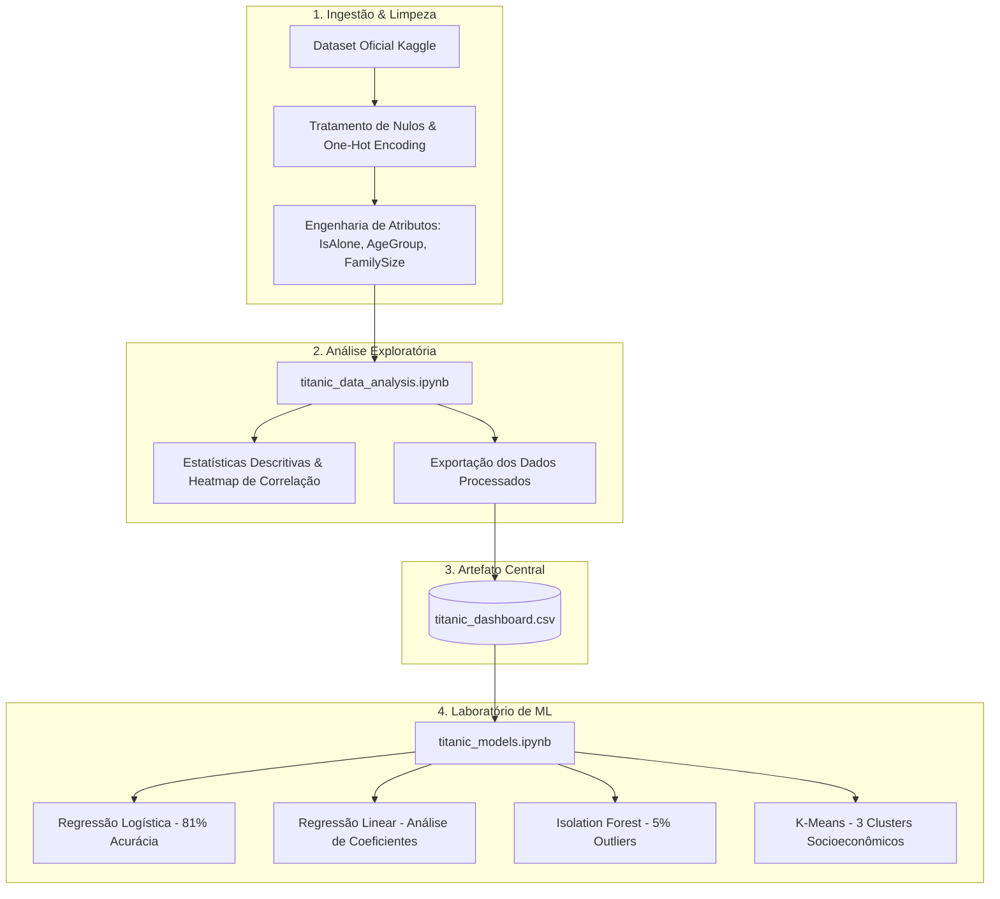

# 🚢 Titanic: Análise Exploratória e Laboratório de Machine Learning


Este repositório reúne um estudo de ponta a ponta em **Ciência de Dados** e **Machine Learning** baseado no célebre naufrágio do RMS Titanic. 

O projeto vai além de um simples classificador de sobrevivência: ele integra uma **análise exploratória aprofundada**, engenharia de atributos comportamentais e um **laboratório prático de modelagem** que aborda quatro paradigmas fundamentais de Machine Learning (Classificação, Regressão, Detecção de Anomalias e Clusterização).

---

## 🧭 Arquitetura do Repositório

```text
Project-Titanic-Data-Analysis/
│
├── 📊 data-analysis/
│   ├── README.md                    # Documentação detalhada da análise exploratória
│   └── titanic_data_analysis.ipynb  # Notebook de EDA, limpeza e engenharia de atributos
│
├── 🧠 models/
│   ├── README.md                    # Documentação técnica e métricas dos modelos de ML
│   └── titanic_models.ipynb         # Notebook com os 4 modelos implementados e avaliados
│
├── 📁 titanic_dashboard.csv         # Dataset limpo, transformado e pronto para consumo
└── 📄 README.md                     # Visão geral do projeto (este arquivo)
```

---

## 🔄 Fluxo do Pipeline de Dados

O projeto foi desenhado de forma modular, onde a saída da etapa de análise alimenta diretamente os experimentos de Machine Learning e possíveis ferramentas de visualização (BI / Dashboards):



---

## 📂 Módulos do Projeto

### 1. [📊 Módulo de Análise Exploratória (`data-analysis/`)](data-analysis/README.md)
Notebook principal: [`data-analysis/titanic_data_analysis.ipynb`](data-analysis/titanic_data_analysis.ipynb)

Focado na compreensão histórica e estatística dos padrões que determinaram as chances de salvamento dos passageiros:
- **Gênero**: Mulheres tiveram taxa de sobrevivência de **74,20%**, contra apenas **18,89%** dos homens, comprovando a diretriz de prioridade nos botes salva-vidas.
- **Classe Social**: Passageiros da 1ª classe apresentaram **62,96%** de sobrevivência, contra **47,28%** na 2ª classe e apenas **24,24%** na 3ª classe.
- **Estrutura Familiar**: Passageiros acompanhados por familiares apresentaram sobrevivência em torno de **50%**, superior aos passageiros solitários (~**30%**).
- **Faixa Etária**: Crianças tiveram taxa de resgate superior (~**53%**), enquanto idosos foram os mais vulneráveis (~**22%**).

👉 *Consulte os gráficos e tabelas detalhados no [README de Análise Exploratória](data-analysis/README.md).*

---

### 2. [🧠 Módulo de Modelos de Machine Learning (`models/`)](models/README.md)
Notebook principal: [`models/titanic_models.ipynb`](models/titanic_models.ipynb)

Um ecossistema experimental que utiliza divisão rigorosa em **Treino (60%)**, **Validação (20%)** e **Teste (20%)** com normalização via `StandardScaler` (sem vazamento de dados):

| Paradigma | Modelo | Propósito Principal | Destaque / Desempenho |
| :--- | :--- | :--- | :--- |
| **Classificação** | **Regressão Logística** | Predição probabilística e binária da sobrevivência | **81,01% de acurácia** no teste final (F1: 0,84 não-sobreviventes / 0,77 sobreviventes) |
| **Regressão** | **Regressão Linear** | Interpretação de coeficientes e discussão de limites | MSE: `0.1463` e R²: `0.3727` (evidencia por que problemas binários demandam sigmoide) |
| **Detecção de Anomalias** | **Isolation Forest** | Isolamento não-supervisionado de desvios | **45 outliers (5%)** detectados (tarifas extremas e idades atípicas) |
| **Clusterização** | **K-Means** | Segmentação comportamental e socioeconômica | **$K = 3$ clusters** delimitados via Método do Cotovelo (*Elbow Method*) |

👉 *Consulte métricas, matrizes de confusão e reflexões no [README de Modelos](models/README.md).*

---

### 3. [📁 Artefato Estruturado (`titanic_dashboard.csv`)](titanic_dashboard.csv)

Arquivo tabular resultante da limpeza e engenharia de dados, contendo 891 registros estruturados:
- `Survived`, `Pclass`, `Age`, `Fare`
- `Sex_female`, `Sex_male` (One-Hot Encoded)
- `Embarked_C`, `Embarked_Q`, `Embarked_S` (One-Hot Encoded)
- `IsAlone` (Indicador booleano/inteiro de passageiro solitário)
- `AgeGroup` (Criança, Adolescente, Adulto, Meia-idade, Idoso)

---

## 🛠️ Tecnologias Utilizadas

- **Linguagem**: Python 3.10+
- **Ciência de Dados & Manipulação**: [Pandas](https://pandas.pydata.org/), [NumPy](https://numpy.org/)
- **Visualização**: [Seaborn](https://seaborn.pydata.org/), [Matplotlib](https://matplotlib.org/)
- **Machine Learning**: [Scikit-Learn](https://scikit-learn.org/)
- **Ambiente Interativo**: [Jupyter Notebook](https://jupyter.org/) / Google Colab
- **Coleta de Dados**: [Kagglehub](https://github.com/Kaggle/kagglehub)

---

## 🚀 Como Executar o Projeto Localmente

### 1. Clonar o Repositório
```bash
git clone https://github.com/KaioGabriel-the/Project-Titanic-Data-Analysis.git
cd Project-Titanic-Data-Analysis
```

### 2. Criar e Ativar Ambiente Virtual (Recomendado)
```bash
# Windows
python -m venv venv
.\venv\Scripts\activate

# Linux / MacOS
python3 -m venv venv
source venv/bin/activate
```

### 3. Instalar as Dependências
```bash
pip install pandas numpy matplotlib seaborn scikit-learn kagglehub jupyter
```

### 4. Executar os Notebooks
Para iniciar a interface Jupyter:
```bash
jupyter notebook
```
- Abra `data-analysis/titanic_data_analysis.ipynb` para visualizar a análise exploratória.
- Abra `models/titanic_models.ipynb` para rodar e testar os modelos preditivos e não-supervisionados.

---

## 👤 Autor

Desenvolvido por **Kaio Gabriel**.
- GitHub: [@KaioGabriel-the](https://github.com/KaioGabriel-the)
