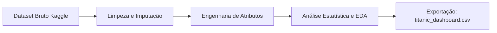

[← Voltar ao README Principal](../README.md)

# 📊 Análise Exploratória de Dados (EDA) - Titanic

Este módulo contém o estudo aprofundado de Análise Exploratória de Dados (EDA) e Engenharia de Atributos sobre o naufrágio do Titanic, implementado no notebook [`titanic_data_analysis.ipynb`](titanic_data_analysis.ipynb).

---

## 📌 Resumo Executivo

O objetivo principal desta etapa é compreender os fatores determinantes na probabilidade de sobrevivência dos passageiros do Titanic. Foram realizadas etapas rigorosas de tratamento de valores ausentes, engenharia de atributos comportamentais e demográficos, estatística descritiva e visualização gráfica de dados. 

Como resultado desta etapa, os dados pré-processados e estruturados são exportados para o arquivo [`titanic_dashboard.csv`](../titanic_dashboard.csv), servindo como base tanto para visualizações analíticas quanto para o treinamento de modelos de Machine Learning no módulo [`models/`](../models/).

---

## 🧭 Estrutura do Módulo

```text
data-analysis/
├── README.md                    # Documentação detalhada da análise exploratória
└── titanic_data_analysis.ipynb  # Notebook interativo com pipeline de EDA e engenharia de dados
```

---

## ⚙️ Metodologia e Pipeline de Dados

O fluxo de análise foi desenvolvido em cinco etapas:



### 1. Ingestão de Dados
- Coleta automática do dataset oficial via `kagglehub` / Kaggle Input (`Titanic-Dataset.csv`).
- Carregamento inicial de 891 registros e 12 colunas originais (`PassengerId`, `Survived`, `Pclass`, `Name`, `Sex`, `Age`, `SibSp`, `Parch`, `Ticket`, `Fare`, `Cabin`, `Embarked`).

### 2. Limpeza e Pré-processamento
- **Remoção de colunas com alta cardinalidade ou sem ganho preditivo direto**: `Name`, `Cabin` (excesso de nulos), `Ticket` e `PassengerId`.
- **Tratamento de Dados Faltantes**:
  - `Embarked`: imputação pela moda (`'S'`).
  - `Age`: imputação pela média aritmética e conversão para valores inteiros.
- **Codificação de Categóricas (One-Hot Encoding)**:
  - `Sex`: conversão em `Sex_female` e `Sex_male`.
  - `Embarked`: conversão em `Embarked_C`, `Embarked_Q` e `Embarked_S`.
- **Padronização**: Conversão de variáveis booleanas para inteiros (`0` e `1`).

### 3. Engenharia de Atributos (*Feature Engineering*)
- **`FamilySize`**: soma de passageiros com laços familiares (`SibSp + Parch + 1`).
- **`IsAlone`**: indicador binário derivado de `FamilySize` (1 se viajava desacompanhado, 0 se acompanhado).
- **`AgeGroup`**: categorização etária em 5 faixas bem delimitadas:
  - Criança (0 a 12 anos)
  - Adolescente (13 a 18 anos)
  - Adulto (19 a 40 anos)
  - Meia-idade (41 a 60 anos)
  - Idoso (61 a 100 anos)

### 4. Análise Exploratória e Visualização
- Cruzamentos estatísticos com agrupamentos (`groupby`) e cálculo de taxas relativas.
- Matriz de correlação com mapa de calor (*Heatmap*).
- Gráficos de barras, distribuições e histogramas utilizando `seaborn` e `matplotlib`.

---

## 📈 Principais Descobertas e Resultados

### Tabela Resumo dos Fatores de Sobrevivência

| Dimensão Analisada | Categoria / Variável | Taxa de Sobrevivência | Impacto Observado |
| :--- | :--- | :---: | :--- |
| **Geral** | Todos os passageiros | **38,38%** | Cenário de baixa sobrevivência global |
| **Gênero** | Mulheres (`Sex_female`) | **74,20%** | Prioridade máxima na evacuação ("mulheres e crianças primeiro") |
| | Homens (`Sex_male`) | **18,89%** | Menor probabilidade de resgate |
| **Classe Social** | 1ª Classe | **62,96%** | Acesso privilegiado aos conveses superiores e botes |
| | 2ª Classe | **47,28%** | Sobrevivência intermediária |
| | 3ª Classe | **24,24%** | Severamente impactados pela localização e barreiras estruturais |
| **Estrutura Familiar** | Acompanhado (`IsAlone = 0`) | **~50,00%** | Cooperação e auxílio mútuo aumentaram o resgate |
| | Sozinho (`IsAlone = 1`) | **~30,00%** | Menor taxa de sobrevivência |
| **Faixa Etária** | Crianças (0 - 12) | **~53,00%** | Proteção prioritária evidente |
| | Idosos (60+) | **~22,00%** | Dificuldade de locomoção e menor prioridade |

### Insights da Matriz de Correlação
- **`Sex_female`**: Apresenta a correlação positiva mais intensa com o desfecho de sobrevivência.
- **`Pclass`**: Correlação negativa pronunciada — quanto menor o número da classe (1ª classe), maior a chance de vida.
- **`IsAlone`**: Correlação negativa com sobrevivência, confirmando que passageiros desacompanhados foram mais vulneráveis.

---

## 💾 Artefato Gerado: `titanic_dashboard.csv`

Ao final do pipeline de limpeza e transformação, o dataset estruturado resultante possui **891 linhas e 11 colunas**:

| Coluna | Tipo | Descrição |
| :--- | :--- | :--- |
| `Survived` | int | Alvo binário: 0 = Não sobreviveu, 1 = Sobreviveu |
| `Pclass` | int | Classe do bilhete (1 = 1ª, 2 = 2ª, 3 = 3ª) |
| `Age` | int | Idade do passageiro (com imputação da média) |
| `Fare` | float | Tarifa paga pela passagem |
| `Sex_female` | int | Indicador binário de sexo feminino (1/0) |
| `Sex_male` | int | Indicador binário de sexo masculino (1/0) |
| `Embarked_C` | int | Embarque em Cherbourg (1/0) |
| `Embarked_Q` | int | Embarque em Queenstown (1/0) |
| `Embarked_S` | int | Embarque em Southampton (1/0) |
| `IsAlone` | int | Passageiro viajava sem familiares (1/0) |
| `AgeGroup` | string | Categoria etária (Criança, Adolescente, Adulto, Meia-idade, Idoso) |

Este arquivo é utilizado diretamente pelo módulo [`models/`](../models/) para experimentos de aprendizado de máquina.

---

## 🛠️ Tecnologias e Dependências

- **Python 3.10+**
- **Pandas**: Manipulação e agregação tabular
- **NumPy**: Operações matemáticas e vetorizadas
- **Matplotlib & Seaborn**: Geração de gráficos estatísticos e mapas de calor
- **Kagglehub**: Download automatizado de datasets do Kaggle

---

## 🚀 Como Executar

1. Certifique-se de que as dependências estejam instaladas:
   ```bash
   pip install pandas numpy matplotlib seaborn kagglehub
   ```
2. Abra o notebook no Jupyter Notebook, VS Code ou Google Colab:
   ```bash
   jupyter notebook data-analysis/titanic_data_analysis.ipynb
   ```
3. Execute as células sequencialmente para reproduzir os gráficos e estatísticas.

